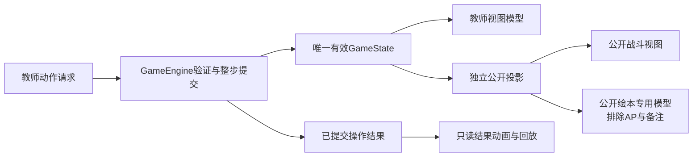

# 交互与SwiftUI接入交接

本轮不改原生源码、不构建、不发布网站。以下是开发对话可据以接真实数据的界面契约；新增公开投影字段需在正式开发中定义，设计文件不是 Swift 代码或规则实现。

## 1. 操作流程

| 操作 | 可审阅步骤 | 结算边界 |
|---|---|---|
| 普攻/伤害技能 | 选动作 → 选择合法目标 →「执行…」 | 选择不扣费/次数，不掷骰；执行验证并一次提交 |
| 移动 | 选移动 → 连续道路路径 → 看实际距离与费用 →「执行移动」 | 规则可在首敌地点截断；只显示提交的实际路径/费用 |
| 自体技能 | 选动作 → 显示自身目标与费用 →「执行…」 | 避免点技能即扣费；不增加确认弹窗 |
| 道具 | 个人背包可用物品 → 合法对象 → 明确执行 | 不能战斗取仓库物；普通药水不能复活 |
| 救援 | 选救援 → 同节点同队倒地对象 → 缺项说明/执行 | AP2+复活石1、半生命向上取整、下轮资格 |
| 多人奖励 | 勾B/C → 底栏「奖励对象：…」 → 金币/AP/积分快捷奖励 | 每人完整一份；执行后反馈各人实际增量，不切行动者 |
| 取消选择 | 清空动作/临时路径/目标 | 不扣资源、不重置时间 |
| 暂停/继续 | Teacher独立按钮 | 叠加原因；继续只解除相应手动原因 |
| 绘本/编辑/历史 | 打开教师视图 → 保留游戏状态 → 返回 | 不刷新技能/队列/计时；移除当前视图暂停原因 |
| 撤销/回退 | Teacher看完整范围 → 恢复整步状态 | 恢复AP、骰子、盾/血、掉落、分数、揭示、阶段与随机状态 |

无奖励对象时显示「请先选择奖励对象」，发奖按钮不可执行；不猜当前行动者。执行过程中禁用重复提交，同一操作ID重试由引擎防重。普通攻击与常规发奖不用额外确认弹框；完整回退/保存模板采用已有需求的明确范围与作用域，不能混为一键当前实例编辑。

## 2. 双画面数据流

公开 View 不接教师备注、完整私有地图、预设随机数、背包、编辑草稿或奖励勾选状态。不先传完整Teacher模型再通过布尔开关遮挡私有信息。公开页面加载和断连重连也读取新公开投影，不能暂时截屏Teacher根视图。

公开战斗中的临时目标、未执行路径不跟随教师选择。已提交攻击/移动可展示焦点与实际结果，奖励执行后的对象/变化可公开；奖励对象选择本身始终私有。

## 3. 对照现有PublicProjection.swift

| 设计信息 | 当前字段 | 接入提示 |
|---|---|---|
| 阶段/轮/行动者/时间/暂停 | phase、round、currentName、remainingSeconds、paused | 可直接表现；Timer仅刷新显示，不能重算规则时间 |
| 角色资源/队伍/主持人/位置/当前 | units 的 name、health、maximumHealth、shield、ap、coins、score、team、host、nodeID、current | 最大生命已经规则推导；不要用职业初始生命覆盖装备或教师调整 |
| 公开节点 | nodes 的 id、name、kind、x、y、revealed | 未探索kind=nil；不得读取私有node类型补图标 |
| 道路 | roads | 按已公开道路表现，视觉线长不等于收费距离 |
| 骰子 | dice | 只显示投影中已有原骰子 |
| 固定队列 | queue当前为姓名字符串 | 同名、倒地、已行动、下轮资格需后续稳定ID与状态；不能用数组位置/名称当唯一绑定 |
| 操作结果摘要 | 当前无独立结构 | 后续增加只含允许公开的已提交结果；不能临时直接读Teacher历史对象 |
| 下轮资格、已行动/跳过 | 当前无公开字段 | 后续加入必要公开标志；生命0可视觉显示倒地，但不能由UI猜本轮资格 |
| 技能成本/次数/合法性原因 | 不在公开快照中 | 教师专用视图模型从当前catalog/本局状态读取，由规则校验给可用性，不由动画推导 |
| 公开绘本 | 当前snapshot包含ap | 为绘本构造专用字段模型/投影；删除AP，不只透明隐藏 |

未实现字段不表示本轮要修改GameCore格式。开发对话可按阶段增补公开投影及结果视图模型，保留规则唯一来源。队列短称、姓名断行是显示层属性，不修改保存的真实姓名或队列顺序。

## 4. 素材、令牌与原生材质

根据资产清单用既有模板ID查询独立透明PNG，使用ASCII文件名；头像 `aspectFit`，不要把姓名/数字放在图片内。样稿不是全套职业定稿，无对应资产时读统一占位组件。未知节点统一中性占位，不使用将来Boss/奖励素材猜内容。

大面积 `Material` 使用系统原生合成，预览的颜色和亮度仅作为目标。小面积液态玻璃依目标系统接口与可读性实现，主要执行和密集资源必要时采用实色；状态不依赖反射高光。实际采用哪一种Material需结合插画、降低透明度和增强对比度核对，不能仅按预览RGBA硬编码“假毛玻璃”。

系统中文/英文字体与等宽数字，常规按钮优先SF Symbols；原创资源小图标按清单本地打包，全部离线使用。令牌集中读取语义名称，避免视图内散落色值。校验无网络字体/图片请求，不把远程预览URL当运行资产。

教师画布根据Geometry和安全区域建立布局。公开窗口以实际宽高选择16:9或4:3网格，保证字号与安全区；不把整个1920×1080根视图一比一缩小来“完成”适配。姓名文本设置预期换行、标记区域，数字保持固定可读宽度。

## 5. 键盘、触控与输入

设计标注可展示数字选人、G奖励、空格暂停等已具备的阶段0键。原需求中的Shift数字、A/S/E/Tab/方向键/撤销及可改绑为后续建议绑定，不宣称已全部可用。正式键位从绑定配置生成提示；每个常规键盘动作有屏幕等价按钮。

备注/姓名/后台数值输入聚焦时关闭游戏快捷键；文本撤销作用于输入文字。按住G不能连续发奖。左栏奖励勾选与当前回合选择是独立命令，不用数字选择自动推进回合；绑定含义由开发版本明确显示。鼠标/键盘焦点有可见描边，点击不是唯一可以到达执行动作的方式。

## 6. 动画、保存与失败

原生视图收到已提交result ID后只读播放；动画回调仅结束表现，不调用apply。重复渲染、旋转/外屏尺寸变化、跳过、回放或App返回前台不会再次抽骰/掉落/积分。自然20文字以原骰子标志判断；不根据总和>=20判断。

结果与状态一致：先提交整步，再表现；若失败，Teacher显示具体原因，保持原已提交状态与时间。保存失败不画资源成功飘字；公开保留上一个有效状态，不播教师存储细节。恢复存档先暂停，外屏显示允许公开的恢复状态，等待教师继续。

降低动态效果仅更换表现策略，所有最终文字与数字相同。学生决策时间、怪物自动回合、PVE结束由规则层管理，不以动画duration控制。
