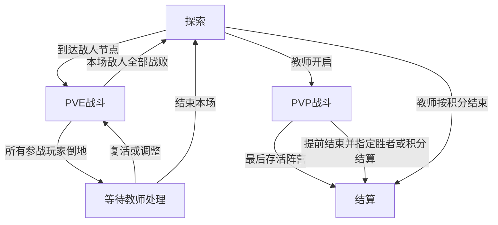

# 英语课堂电子桌游：需求与规则设计 v1.0

版本日期：2026-10-12（北京时间）  
用途：供教师审阅，以及后续在 Codex 中逐阶段开发。本文是设计规格，尚未实现应用。  
配套文件：课堂桌游_开发步骤_v1.md。

## 1. 设计依据与目标

### 1.1 规则标记

- **已确认**：教师在讨论中明确选择的规则与初始数据，开发应原样实现。
- **补充默认**：为使流程完整而给出的边界处理或初始预设，可在后台配置或后续调整；不表示教师逐项投票确认。
- **待验证**：涉及真实设备、安装方式、外接显示或文件兼容性的技术条件，必须通过开发阶段0验证。

未讨论的功能不应自动扩大为首版需求。技术实现不得改变已确认的课堂规则。

### 1.2 产品目标

教师在英语课堂中主持一个电子化、问答驱动、具有骰子战斗和探索的桌游。学生通过口头讨论决定行动；教师提问、评价回答，并操控游戏。游戏服务于课堂节奏，教师可以随时发奖、暂停、调整和结束。

| 项目 | 已确认需求 |
|---|---|
| 人数 | 1—6名学生；主持人可另有参战角色，最多7个玩家角色 |
| 操作设备 | 教师使用iPad，具有实体键盘 |
| 展示方式 | 无线投屏，目前使用屏幕镜像；技术实现尚未确定 |
| 学生操作 | 首版由教师操作，学生无需个人设备或账号 |
| 课堂题目 | 全部由教师准备，选择题与判断题也并入PPT |
| 答题判断 | 教师自行判断；后台无需题库、答题记录或英语能力评估 |
| 奖励 | 教师手动发金币，也可调整行动点、道具、积分等游戏资源 |
| 教学材料 | 导入现有静态PPTX及演讲者备注；台词只给教师看 |
| 游戏流程 | 前期PVE；后期由教师开启PVP或按积分结算 |
| 联网要求 | PPTX导入、游戏运行、存档全部可以本地离线完成 |
| 使用范围 | 教师个人使用；无Mac，优先避免付费依赖 |

不设计独立题库、学生在线答题端、自动英语评分、战法牧人数依赖、独立任务卡或云账号。等级成长、制作、强化等系统未纳入首版。

### 1.3 技术可行性边界

**双画面隐私与离线PPTX导入是首版核心要求，不是已验证能力。**

目前没有获得教师的实际PPTX文件，也未在其iPad与投屏接收设备上验证。技术选型、安装方式与费用条件仍待验证。不能把“主界面隐藏备注”当成双画面隐私已通过，也不能以图片导入或在线转换偷偷代替已选择的离线PPTX导入。

如阶段0发现硬性要求无法同时满足，先记录实测结果及具体替代方案，再与教师讨论该项范围；其余已确认规则保持原意。

## 2. 状态与课堂主流程

### 2.1 三个彼此独立的状态维度

| 维度 | 状态 |
|---|---|
| 游戏阶段 | 准备、探索、PVE战斗、PVP战斗、结算 |
| 教师视图 | 游戏、绘本、详细编辑、历史记录 |
| 暂停原因 | 手动暂停、绘本打开、编辑面板打开、历史面板打开、全员倒地等 |

切换视图不等于结束战斗。进入绘本保留回合、队列、位置、剩余时间和技能次数。

### 2.2 标准课堂流程

1. 导入或选择本地绘本；创建新局；添加学生与可选主持人角色，分配职业、队伍。
2. 输入地图节点总数；查看并修改系统推荐的节点类型数量；随机生成地图。
3. 检查生成结果；可替换单个节点的怪物或奖励，或整图重生成。
4. 探索由教师推进。学生讨论后，教师选择角色和连续路径，扣除移动行动点。
5. 到达敌人地点自动开战；所有玩家按当前位置加入队列。教师可暂停或取消。
6. 教师可随时讲绘本、口头提问、使用奖励快捷键。
7. PVE结束自动返回探索。教师手动开放商店、处理交易与换装。
8. 结尾由教师开启团队PVP／个人混战，或直接积分结算。
9. 可导出存档；下次继续该局保留完整进度。新开一局重置角色资产与积分，可重新分配职业。

补充默认：常规PVP从探索阶段进入；如正在PVE，教师先结束或取消该战斗，再配置PVP，避免两套行动队列同时存在。

## 3. 角色、队伍与参与身份

### 3.1 角色

四档职业有明确强弱差异，越强越全面，同时兼顾生存、输出和增益。每职业3个主动技能。武器普攻独立于职业技能。

| 职业 | 初始最大生命 | 基础行动点 | 默认行动点上限 |
|---|---:|---:|---:|
| 冒险者 | 12 | 3 | 8 |
| 游侠 | 18 | 3 | 8 |
| 魔剑士 | 24 | 3 | 8 |
| 龙骑士 | 32 | 3 | 8 |

职业由教师分配；装备通用，无职业限制。主持人参战角色使用相同规则，个人分与队伍分照常计算；操控该角色不会失去教师后台权限。

补充默认：新角色满生命、行动点3、护盾0、金币0、积分0，赠送训练短剑，护甲与饰品为空。教师可调整初始配置。

### 3.2 队伍

- 支持教师随时创建、合并、拆分队伍或调整成员；教师确认后立即生效。
- 金币、物品、积分跟随角色；行动点始终个人持有，不能转移。
- 每队一个共享仓库，可存金币和物品；探索时可存取。
- 同队之间可转金币和物品；跨队由教师后台调整。
- 队伍总分实时等于当前成员个人分之和。

补充默认：换队后个人背包保留，旧队仓库留在旧队；教师可手动处理无人队伍的仓库。换队不恢复生命、不补行动点、不刷新技能次数、不重新分配已结算奖励。

## 4. 行动点、回合与计时

### 4.1 行动点补充

玩家基础值默认3，上限默认8，均可逐角色配置。补充为“补足基础值”，不是叠加基础值：

补足后行动点 = min(行动点上限, max(当前行动点, 当前基础行动点))。

例如当前2点、基础3点，变为3点；当前6点，仍为6点。

| 场景 | 补充规则 |
|---|---|
| 新战斗开始 | 执行一次基础补足，刷新本场技能次数 |
| 战斗新一轮 | 每个玩家与参战怪物按各自基础值补足 |
| 探索 | 教师手动触发基础补足，不能按时间自动刷新 |
| 课堂奖励 | 教师追加，默认遵守角色储存上限 |
| 手动结束回合 | 剩余行动点保留 |
| 决策超时 | 剩余行动点清零，自动结束回合 |
| 行动点耗尽 | 自动结束回合 |

调整上限后若当前点数超过新上限，补充默认立即截到上限，并在后台显示变化；上限必须不小于基础值。

### 4.2 固定行动队列

- 玩家和参战怪物混排，开战掷骰排序，之后沿用；教师可以调整。
- 所有玩家自动加入，位置不变，远处玩家可在自己回合赶来。
- 新怪物中途激活后立即能被攻击；掷骰插入固定队列，但下一轮才开始行动。
- 教师改队列不额外赠送已经消耗的回合。

补充默认：先攻用D20，高值先行动；平值随机确定固定先后，教师可覆盖。先攻骰不产生秒杀。轮内记录已行动状态、复活后的可行动轮数，不能仅依赖队列索引判断是否可再行动。

### 4.3 每次行动决策计时

- 默认30秒，可修改、暂停或临时延长。
- 每次有效移动或攻击完成后重新开始30秒；移动可选连续路径，整个路径算一次移动操作。
- 行动可以自由穿插，例如移动→攻击→移动→技能。
- 提问时教师点击暂停，冻结剩余时间；恢复时继续剩余时间。
- 打开详细编辑或历史面板自动暂停；关闭后恢复此前状态和剩余时间。
- 进入绘本自动暂停；回游戏恢复此前状态和剩余时间。

补充默认：技能、使用道具、救援等有效行动也重启决策计时；打开详情、取消选择、无效操作不重启。骰子动画、结算及怪物自动行动不占学生决策时间。探索没有自动回合计时器。

暂停原因应叠加管理。例如原本手动暂停，再打开绘本，返回游戏仍然手动暂停；关闭一个面板不能解除其他暂停原因。

## 5. 地图、生成与探索

### 5.1 地图结构

- 节点表示房间或地点，道路为连线；多个玩家和怪物可在同节点。
- 所有道路统一消耗1行动点，始终可通行；剧情节奏由教师推进移动。
- 攻击射程按最短路径的道路数量计算；同节点距离0。
- 战斗直接使用原地图，不另切战斗场景。

### 5.2 随机生成

已确认：指定节点总数；道路结构、节点内容都随机；系统按总数建议各类节点数量，教师可修改后生成；生成后可替换单节点的怪物或奖励，也可整图重生成。首版不要求教师手工绘制道路。

补充默认：

- 默认10节点：起点1、普通战斗4、Boss1、奖励3、空地点1。
- 节点总数可设4—30；该范围是首版可调整的界面预设。
- 自动建议：1起点、1Boss；普通战斗数为floor(0.4N)，奖励数为floor(0.3N)，其余为空节点；教师可改Boss数，包括0。
- 数量校验：各类数量为非负整数，起点固定1，总和等于总节点数。
- 所有节点连通，道路为双向，无自环和重复边。允许分叉和环路。
- 先生成一张连通树，再随机加入少量道路；布局避免标签与连线严重重叠。
- 起点无怪物；Boss优先放在离起点较远节点，不设置锁门。
- 保存生成种子和实际地图；继续存档直接读实际地图，不重新随机。
- 整图重生成用于开局准备阶段；进行中的地图可改单节点内容，若要完全换图，应新开局，避免重置已领取奖励。
- 单节点已完成奖励不会因改内容自动恢复领取；教师可明确重置该节点事件，作为一条后台操作记录。

### 5.3 怪物组合推荐

已确认系统按人数给推荐，教师确认后放置，不自动修改怪物属性。下面为补充默认：

| 学生人数 | 简单 | 标准 | 较强 |
|---|---|---|---|
| 1—2 | 史莱姆×1 | 森林狼×1＋哥布林弓手×1 | 石像守卫×1 |
| 3—4 | 史莱姆×2＋森林狼×1 | 森林狼×2＋哥布林弓手×1 | 石像守卫×1＋哥布林弓手×1 |
| 5—6 | 史莱姆×3＋森林狼×1 | 森林狼×2＋哥布林弓手×2 | 石像守卫×2＋哥布林弓手×1 |

Boss默认单只，由教师选巨魔或魔龙。推荐人数默认只统计学生；主持人参战显示提示，组合仍由教师确认。此表是准备建议，不承诺固定难度或自动平衡四档职业。

### 5.4 移动与揭示

- 探索由教师选择一人或多人同行，选择连续路径，每人独立扣除经过道路所需行动点。
- 新到达地点揭开自身内容、相邻道路及目的地轮廓；目的地内容到达后揭开。
- 地图发现全员共享。
- 到达有敌人节点自动开战，教师可以暂停或取消。

补充默认：

- 多人同行使用同一出发节点和路径；不同出发地点分批移动。
- 移动前检查全员资源；有人不足时整组不移动，教师调整同行人员或补点后重试。
- 路径遇到第一个敌人节点停止，只扣实际经过的道路消耗；所有同行者作为同一次到达。
- 战斗中只有当前行动角色正常移动；教师可用后台调整位置。
- 教师可手动揭示地点；非实际到达的揭示不会领取奖励。
- 若从远处攻击尚未参战的怪物，该怪物按中途加入规则激活。

### 5.5 地点奖励事件

首版仅配置金币、道具、积分奖励，不建立独立任务卡。每个事件整局仅触发一次，重复进入显示已完成。

到达自动结算，无需教师确认。多人同次到达，每位到达者各得一份；以后到达者不再领取。

补充默认：每个节点最多一个奖励事件，可组合多个奖励项；初始奖励节点为每人金币10、积分2，道具另配。积分2是默认事件积分，可逐事件修改，不能再另外叠加一次“完成事件2分”。触发时锁定本次到达者名单，先把整次奖励结算完整，再检查战斗或其他阶段变化。

## 6. 攻击、技能效果与倒地

### 6.1 攻击与伤害

| 项目 | 规则 |
|---|---|
| 命中 | 有效目标、合法射程下必定命中，无命中骰、闪避或护甲等级 |
| 武器普攻 | 每次1行动点，伤害骰与射程按武器 |
| 技能 | 逐技能配置行动点、伤害骰、目标、射程、次数、使用阶段 |
| 支持伤害骰 | D4、D6、D8、D10、D12、D20；同类多骰与固定加值 |
| 常驻减伤 | 不设防御值；护甲以生命、伤害、行动等属性或套装效果体现 |
| 普通伤害 | 先扣护盾，再扣生命；生命最低0 |
| 群体伤害 | 只掷一次，全体使用同一结果 |
| D20自然20 | 本次伤害目标直接生命归0，穿透护盾；Boss与PVP玩家均适用 |

只在伤害用D20的自然结果为20时秒杀，不额外掷一枚通用D20。例如D20掷出18再加2不秒杀；先攻、治疗等非伤害骰掷20也不秒杀。怪物伤害同样适用。

补充默认：若以后配置多枚D20，任一枚自然20即使该次伤害全部目标进入倒地／战败；其他骰种的最大值不秒杀。正常伤害最终为max(0,骰子总和＋固定加值＋常驻增伤＋临时增伤)。无效行动不扣行动点、不扣次数、不掷骰。

### 6.2 生命、护盾与增益

- 护盾不叠加：新值与旧值取较高者。
- 战斗结束保留剩余护盾，直到消耗、被更高值替换或倒地。
- 临时增益逐技能配置持续轮数，战斗结束统一清除。
- 技能可配置战斗专用、探索专用、两者皆可。

补充默认：

- 治疗不超过最大生命，普通治疗不能救起倒地角色。
- 常驻装备属性与已激活套装档位累加；临时同类增益取较高值，相同或更高值重施刷新持续时间。
- 伤害增加作用于普攻和伤害技能。
- 当轮施加的增益不在当轮末减计数，后续每轮末减1；1轮增益覆盖施加轮剩余时间和下一整轮，之后移除。
- 探索阶段没有自动轮计数；战斗结束会清除临时战斗增益。
- 最大生命增加只提高上限，不自动治疗；降低后当前生命超过上限则截断。
- 基础行动点增加不即时补点，下一次正常补足才体现。
- 装备射程属性如后续增加，默认作用于武器与技能；普通道具使用自身射程，救援始终同节点。

### 6.3 倒地与救援

生命归0：玩家倒地，怪物战败。倒地不自动扣分或扣其他资源。

队友救援必须：

1. 救援者与倒地队友同节点；
2. 救援者花2行动点；
3. 消耗其个人背包中的1颗复活石；
4. 被救者恢复ceil(最大生命÷2)生命；
5. 战斗当轮不能行动，下一轮按原队列行动。

所有复活统一半最大生命向上取整。教师可直接执行后台复活。

补充默认：倒地清除护盾与临时增益，保留金币、物品、积分和剩余行动点；倒地者跳过行动但仍按轮基础补足，可接受教师奖励。探索复活立即恢复可探索状态，因为探索没有轮次。无效救援不扣点或道具。救援只在双方实际满足条件时加分。

### 6.4 战斗结束

- 本场参战敌人全部战败：自动结束PVE，回探索。
- 所有参战玩家倒地：暂停，等待教师复活、调整或结束本场，不自动惩罚。
- 一次行动的伤害、附带治疗／护盾、所有击杀、掉落和积分全部结算完，才判断结束。
- 战斗结束清临时增益，保留生命、护盾、资源与剩余行动点。

## 7. 怪物自动行动

怪物也用行动点，每轮按其基础值补足；移动一道路1点、普攻1点，足够可以连续攻击。

每个怪物模板设置选敌策略：最近敌人、生命比例最低的敌人、随机敌人。技能按优先级与简单条件自动施放，不能施放则移动或普攻。

补充默认AI流程：

1. 跳过战败或本轮尚不可行动的怪物。
2. 查找当前合法敌人，检查技能的条件、射程、行动点及次数。
3. 满足条件则施放优先级最高的可用技能；再次检查剩余行动点。
4. 否则选敌；在普攻范围内攻击，范围外沿最短路径接近。
5. 目标倒地后重新选敌；行动点不足或无有效行动时结束。

相同优先级／距离默认随机选择，并记录结果。随机选敌在当前目标倒地或失效时重选，避免每走一步无意义换目标。AI不等待30秒计时器。已战败怪物不自动重生；教师可添加新实例。

## 8. 装备、背包、商店与经济

### 8.1 装备与物品

- 穿戴槽：1武器＋1护甲＋1饰品；个人背包容量不限。
- 战斗中不能换装备；探索可随时换装。
- 普通消耗道具每次1行动点，探索与战斗均适用；复活石救援固定2点。
- 道具逐项配置目标与射程，可跨节点帮助队友。
- 战斗只能使用个人背包中的物品，不能即时从仓库取物。
- 探索允许同队转金币／物品、存取队伍仓库；跨队教师调整。

补充默认：探索换装、资源转移、仓库存取不耗行动点，无同节点要求。已穿戴装备先卸下才能转走；买卖穿戴装备可在探索中自动卸下并重算属性。饰品、套装提高上限时不自动补生命或行动点。

### 8.2 商店与价格

- 教师手动开放／关闭商店。
- 仅探索可购买、出售，所有角色都能买，不限所在节点。
- 普通商品全部上架，包括D20权杖；固定价格、无限库存。
- 稀有套装不出售，仅怪物掉落或教师发放。
- 出售默认买价一半向下取整，逐商品可改；稀有装备使用独立回收价。

补充默认：购买由个人金币支付、物品进入个人背包；出售所得归个人。交易不耗行动点；金币不足或背包无货不产生部分交易。共享金币先取到个人再购买。

### 8.3 经济节奏

常规课堂奖励以10金币为参考，但教师自由决定金额。普通怪物每只50%掉5金币，Boss每只必掉30金币，概率与金额可逐模板修改。

金币和物品的每项掉落独立判断，可能多项同时掉，也可能普通怪物没有掉落。所有掉落归最后完成击杀的角色；群体击杀逐怪物独立计算，均归该行动角色。

补充默认：自动奖励不依赖角色是否为学生。教师直接改怪物生命到0时，若没有指定击杀归属，不自动给任意角色发击杀分或个人掉落；可另行选择归属或手动发放。

### 8.4 套装

每套由武器、护甲、饰品组成。仅穿戴计件，背包和仓库不计。2件加成和3件加成累加，3件时增加套装主动技能，成为“3个职业技能＋1个套装技能”。

套装技能使用同样的行动点、目标、射程、次数和阶段配置。补充默认：本场已使用次数跟随技能记录，卸下再穿上不刷新次数。

## 9. 积分、PVP与结算

### 9.1 积分

| 自动加分事件 | 初始分值 | 归属 |
|---|---:|---|
| 击败普通怪物 | 1 | 最后完成击杀者 |
| 击败Boss | 5 | 最后完成击杀者 |
| 完成地点奖励事件 | 2 | 本次到达并获得奖励的每位角色 |
| 成功救援队友 | 2 | 救援者 |
| PVP击倒对手 | 每次2 | 最后完成击倒者 |

怪物和地点事件逐个可配置分值，救援与PVP分值可全局修改。系统仅自动加分；扣分由教师手动调整。主持人角色照常计分。个人分始终跟随角色，队伍排名取当前成员总分；相同积分并列名次。

补充默认：排名使用竞赛名次，如1、1、3。资源奖励与积分相互独立，金币不兑换积分。记录积分来源和操作归属，便于撤销。

### 9.2 PVP

- 教师每场选择团队战或个人混战。
- 继承当前生命、护盾、行动点；开战按基础值补足行动点，技能次数补满。
- 默认保留装备、背包、金币、积分，沿用当前地图。
- 最后存活阵营获胜：团队看存活队伍，混战看存活个人。
- 击倒同一对手后其被复活再倒地，仍按每次2分计。
- 提前结束而仍有多个存活阵营：教师指定胜者，或改按积分结算。

补充默认：

- PVP启动界面确认模式、阵营、位置与当前资源，至少两个存活阵营才能正常开赛；不会自动治疗已倒地角色。
- 团队战以当前队伍判断友敌；混战每人是独立战斗阵营，不因原探索队伍而成为战斗盟友。
- 混战不能用普通队友救援；教师后台仍可复活。团队战可正常救援。
- PVP不掉落玩家金币或装备，不触发怪物击杀分；只触发PVP击倒分。
- PVP结算显示战斗胜者和积分排名，两者分别记录。
- 改按积分时，团队战默认看当前队伍总分，混战默认看个人分；教师可选择展示另一榜单。
- 若一次效果后无存活阵营，暂停等待教师裁定或积分结算，不随机指定胜者。

## 10. 教师后台、快捷键与历史

### 10.1 教师常用操作

| 类别 | 必须支持 |
|---|---|
| 选择 | 选择单角色或多角色；当前行动角色与奖励对象区分显示 |
| 奖励 | 金币、行动点、物品、积分，支持可编辑奖励组合与快捷键 |
| 状态 | 生命、护盾、行动点、金币、积分、技能剩余次数、倒地／复活 |
| 队伍 | 创建、拆分、合并、成员调整、队伍仓库 |
| 位置 | 移动角色、怪物；揭示地图；调整单节点怪物／奖励 |
| 战斗 | 暂停／恢复、延长计时、改队列、加怪物、取消／结束战斗 |
| 商店 | 开放／关闭，改商品价与回收价 |
| 内容 | 编辑职业、怪物、装备、技能、奖励与掉落 |
| 结束 | 开启PVP、指定胜者、按积分结算 |
| 纠错 | 撤销最近完整操作；从历史记录选择某一步回退 |

所有课堂修改默认只影响本局；另有明确“保存为模板”操作，用于今后新局。既有存档持有自己的模板快照，不能被以后模板编辑悄悄改写。

补充默认：教师后台可越过正常战斗限制直接调整资源和状态，但尊重数据有效性；不能存入负数量物品、超过实际最大生命或坏掉的节点引用。金币不允许负数，教师积分可为负。后台资源调整与正常攻击区分来源，避免误发击杀分。

### 10.2 快捷键

已确认覆盖：选择角色、发奖、暂停、结束回合、绘本翻页、视图切换、撤销；允许自定义绑定。

下面是可修改的初始键位建议，并非已确认的固定键位：

| 建议按键 | 功能 |
|---|---|
| 1—6；7 | 选择对应学生；选择主持人 |
| Shift＋数字 | 切换该角色多选状态 |
| G | 向选中角色各发金币10 |
| A | 向选中角色各追加行动点1 |
| S | 向选中角色各加积分2 |
| 空格 | 手动暂停／恢复 |
| E | 当前角色手动结束回合，保留剩余行动点 |
| 左／右方向键 | 绘本上一页／下一页 |
| Tab | 游戏／绘本切换 |
| Command或Ctrl＋Z | 撤销最近完整游戏操作 |

快捷键必须有屏幕按钮等价操作。发奖支持多人，每人获得完整数额；动作发生后显示对象和实际变化，行动点触顶时显示实际获得量。

补充默认：未选对象时不发奖、不默认猜测对象。当前行动角色与奖励对象独立，教师发奖不会切换回合。文本输入框正在编辑时暂停游戏快捷键；标准文字撤销只作用于输入内容。长按键不连续发奖；绑定冲突可提示并修改。单人7号位置仅在主持人角色存在时启用。

### 10.3 完整操作与撤销

一次攻击的行动点、骰子结果、伤害、附带效果、倒地、掉落、积分、队列跳过和战斗结束属于同一完整操作，一起撤销。不能只恢复生命而留下已领取物品。

支持连续撤销最近操作，也支持历史界面选择某一步“完成之后”的状态，回退此后的全部操作。移动要连同揭示、到达奖励与自动开战一起恢复；交易要同时恢复双方金币和物品。

补充默认：

- 历史记录只保存游戏操作，不保存课堂题目或答题评价。
- 记录序号、对象、操作类型、资源变化、骰子、掉落、积分原因。
- 回退包括游戏阶段、地图完成标记、队列、计时剩余、资源和随机状态。
- 从历史状态继续形成新分支，后面的旧分支不再作为当前局未来动作执行。
- 同一已记录操作回放使用原骰子和掉落结果，不能因重绘、读档或回放重新掷骰。
- 历史界面先显示回退范围；回退执行期间暂停，关闭后按恢复出的阶段及其他暂停原因继续。
- 普通切换界面不污染游戏操作历史；保存模板属于配置操作，游戏回退不撤销模板库修改。

## 11. 绘本、教师画面与公开画面

### 11.1 PPTX导入目标

- 从iPad本地选择现有PPTX。
- 离线读取静态页面和对应演讲者备注。
- 保留页序、文字与图片的可读性；不需要动画、视频或交互PPT。
- 教师页显示当前页与对应台词；公开页显示绘本内容和简略玩家状态。
- 一键／快捷键返回游戏，再返回绘本保留原页码。

补充默认：教师可在导入后修正每页台词；此编辑不修改原PPTX。空备注显示为空，长备注可独立滚动，备注滚动不改变公开页。导入报告列出缺失字体、无法处理的对象或页面失败；不静默生成空白页。原文件与处理后的本地页面一起保存。

阶段0必须使用教师实际文件测试；若涉及外部服务器转换，就不满足已确认的全离线要求。

### 11.2 公开状态条

已确认每个角色显示：姓名、当前／最大生命、护盾、金币、积分、所属队伍。绘本状态条不显示行动点。主持人参战角色也显示。

补充默认：队伍用名称或颜色，倒地有明确标记；最多7名角色仍需保持绘本可读。状态条可展开查看，但教师的备注和后台字段永远不进入公开数据。

### 11.3 双画面要求

| 教师画面 | 公开画面 |
|---|---|
| 备注、编辑、奖励对象选择、地图完整内容、历史、快捷键设置 | 已揭示地图、角色状态、行动信息、公开骰子结果 |
| 绘本页及私有台词 | 绘本页及公开状态条 |
| 教师控制按钮 | 适合观看的信息布局 |

两个画面读取同一游戏状态，但公开显示数据单独构造，不能先传备注再靠遮挡隐藏。菜单切换、崩溃恢复、外接屏断连重连也要验证台词不泄露。

补充默认：公开游戏视图显示当前轮、当前角色、队列、倒计时、资源与公开战斗日志；教师可选择何时展示排行榜。敌方未揭示信息保持隐藏。技术实现需真实设备验证，不能以单屏录屏代替。

## 12. 离线存档、模板与新局

### 12.1 本地能力

PPT导入与页面处理、游戏规则、随机生成、音画资源、自动保存、手动存档、模板编辑、备份导入导出均在本地完成。核心操作不依赖账号、云存储、在线骰子或服务器。

补充默认：

- 每次完整游戏操作成功后自动保存；另设带名称的手动存档。
- 保存采用完整事务与原子替换，不能出现半次购买或半次掉落。
- 后台可管理本地绘本、模板和存档；这些属于教师自己的课堂资料。
- 暂停后记录实际剩余时间；应用中断后恢复存档先暂停，教师点击继续，避免打开时立刻超时。
- 导出包包含状态、模板快照、操作历史、随机状态、绘本页面、备注和必要资产，可在断网下导入。
- 导入先校验版本与完整性，再导入为独立存档；失败不覆盖现有数据。
- 没有删除原PPTX或既有存档的自动清理行为。

### 12.2 新局与继续

| 操作 | 规则 |
|---|---|
| 继续存档 | 原地图、位置、资产、积分、事件、战斗队列、绘本页码完整恢复 |
| 新开一局 | 金币、装备、背包、积分、队伍仓库、地点完成状态等全部重置；职业可重分配 |
| 使用模板新局 | 读已保存模板的初始数据，再生成地图；不能继承上一局资产 |

补充默认：新局可复用学生姓名和绘本选择，作为课堂准备便利；角色重新按所选职业满生命、基础行动点、初始装备生成。旧存档保留，新局不覆盖旧局。

## 13. 数据结构与实现约束

以下是领域设计，不限定语言、框架或数据库。

| 数据对象 | 必要内容 |
|---|---|
| 游戏模板 | 模板版本、职业、技能、物品、套装、怪物、掉落、评分、地图预设、快捷键 |
| 本局状态 | 局ID、阶段、轮次、暂停原因、剩余计时、当前角色、模板快照 |
| 玩家实例 | ID、姓名、是否主持人、职业、队伍、节点、生命、护盾、行动点、金币、积分、背包、装备、技能次数、增益、可行动轮 |
| 队伍 | ID、名称、成员；仓库独立记录，队伍分从成员实时计算 |
| 怪物实例 | 模板引用、所属节点、生命、护盾、行动点、参战状态、首次可行动轮、技能次数 |
| 地图 | 节点、道路、布局、生成种子、揭示状态；节点内怪物、奖励事件与完成标记 |
| 技能定义 | 场景、行动点、目标类型、范围、骰子与加值、治疗／护盾／增益、持续轮数、次数、AI条件 |
| 物品定义 | 槽位或消耗类型、属性、攻击、目标、射程、买卖价、套装ID |
| 物品实例／堆叠 | 实例ID或定义ID、数量、归属、穿戴状态；独立实例编辑时不误改所有同名物品 |
| 掉落表 | 每条物品／金币、数量、独立概率；稀有物品亦逐条配置 |
| 战斗 | 战斗类型、阵营、固定队列、已行动标记、参战怪物、胜者 |
| 操作记录 | 操作ID、类型、执行角色或教师、前后状态、骰子和掉落、资源与分数原因 |
| 绘本 | 原文件引用、页序、静态页资产、私有备注、当前页、导入报告 |
| 存档包 | 格式版本、完整状态、模板快照、历史、随机状态、绘本与资产清单 |

规则计算与显示分离；教师画面和公开画面共享唯一有效状态。教师操作先校验、再完整结算、提交一次状态、记一次历史、保存一次；显示动画不能再次执行规则。

暂停是状态而非“减小计时速度”。计时应依据剩余有效时长，而非要求每秒刷新绝不丢帧。打开后台期间的时间不应算作学生决策时间。

## 14. 全局配置与校验

| 项目 | 初始值／规则 | 后台范围 |
|---|---|---|
| 决策时间 | 30秒 | 全局默认、当场延长／暂停 |
| 玩家基础行动点／上限 | 3／8 | 逐角色；装备可增加 |
| 移动／普攻成本 | 1／1 | 首版固定规则 |
| 普通消耗品成本 | 1 | 首版固定规则 |
| 救援成本／恢复 | 2点＋复活石；半生命向上取整 | 首版固定规则 |
| 技能 | 附录A与套装技能 | 逐技能配置完整参数 |
| 评分 | 普通1、Boss5、事件2、救援2、PVP2 | 模板或全局；教师可加减 |
| 商品 | 附录B | 买价、回收价、属性；无限库存 |
| 掉落 | 附录D | 逐项概率与数量 |
| 地图总数 | 建议默认10 | 默认范围4—30，可调整设计 |
| 地图分布 | 1／4／1／3／1 | 生成前可调整 |
| 快捷键 | 10.2节建议键位 | 全部可自定义 |

最小校验：生命上限≥1，行动点基础≥1，上限≥基础；射程、持续轮数、物品数量是合法整数；每场次数为非负整数或不限；概率0—100%；价格非负；引用ID有效；地图连通；物品只能占一个槽；套装武器／护甲／饰品各一件。

数字编辑的作用范围必须明确：修改当前实例仅改该对象；修改本局定义可明确应用到本局同类实例；保存为模板须明确写回哪项定义。不能把当前生命误保存成职业最大生命。

## 15. 初始内容附录

下面附录A—D的职业技能、普通商品、怪物、套装及掉落为讨论已确认模板；附录E为补充默认的地图奖励与组合建议。所有模板仍允许教师编辑。

### 附录A：12个职业主动技能

“节点队友”包括位于该节点的施法者自身。表内伤害为基础公式，另加实际生效的装备／套装／临时增伤。

| 职业 | 技能 | 行动点 | 目标／射程 | 效果 | 每场次数 |
|---|---|---:|---|---|---:|
| 冒险者 | 强击 | 1 | 单敌／0 | 1D6＋2伤害 | 2 |
| 冒险者 | 喘息 | 1 | 自己 | 恢复4生命 | 2 |
| 冒险者 | 简易防护 | 1 | 自己 | 获得4护盾 | 2 |
| 游侠 | 突袭 | 2 | 单敌／1 | 2D8＋2伤害；自己恢复3生命 | 2 |
| 游侠 | 援护 | 1 | 单队友／1 | 恢复6生命，获得4护盾 | 2 |
| 游侠 | 振奋 | 1 | 一个节点全部队友／0 | 伤害＋2，持续1轮 | 2 |
| 魔剑士 | 符文斩 | 2 | 单敌／1 | 2D12＋2伤害；自己恢复4生命、获得4护盾 | 2 |
| 魔剑士 | 符文庇护 | 2 | 一个节点全部队友／1 | 恢复8生命、获得6护盾 | 2 |
| 魔剑士 | 战斗符文 | 1 | 一个节点全部队友／1 | 获得4护盾，伤害＋3持续2轮 | 2 |
| 龙骑士 | 龙焰 | 2 | 一个节点全部敌人／1 | 1D20＋6伤害；自己恢复6生命、获得6护盾，伤害＋2持续2轮 | 1 |
| 龙骑士 | 龙鳞庇护 | 2 | 一个节点全部队友／1 | 恢复12生命、获得10护盾，伤害＋2持续1轮 | 2 |
| 龙骑士 | 龙之号令 | 2 | 一个节点全部队友／1 | 恢复6生命、获得8护盾，伤害＋4持续2轮 | 1 |

场景补充默认：强击、突袭、符文斩、龙焰为战斗专用，其余两者皆可。新局与新战斗初始化可用次数；探索沿用当前剩余次数，教师可以补充，不能因界面切换刷新。首版技能没有另外的魔法值或冷却时间。

### 附录B：普通商品与道具

金币计价。所有普通商品在教师打开商店后都可买，无限库存。

| 名称 | 类型／槽位 | 效果或攻击 | 买价 | 默认回收价 |
|---|---|---|---:|---:|
| 训练短剑 | 武器 | 1D6；射程0；新角色赠送1把 | 10 | 5 |
| 猎弓 | 武器 | 1D8；射程1 | 50 | 25 |
| 重剑 | 武器 | 1D12；射程0 | 100 | 50 |
| 传奇权杖 | 武器 | 1D20；射程1；自然20秒杀 | 200 | 100 |
| 皮甲 | 护甲 | 最大生命＋4 | 30 | 15 |
| 符文甲 | 护甲 | 最大生命＋8 | 60 | 30 |
| 力量徽章 | 饰品 | 普攻和伤害技能伤害＋2 | 50 | 25 |
| 行动戒指 | 饰品 | 基础行动点＋1；上限不变 | 100 | 50 |
| 小治疗药水 | 消耗品 | 恢复6生命 | 10 | 5 |
| 大治疗药水 | 消耗品 | 恢复12生命 | 20 | 10 |
| 护盾药水 | 消耗品 | 获得8护盾，取与旧值较高者 | 15 | 7 |
| 复活石 | 消耗品 | 同节点队友救援；消耗2行动点；复活半最大生命 | 30 | 15 |

小／大治疗与护盾药水：可对自己或射程1内队友使用，每次1行动点，探索与战斗均可。复活石使用已确认救援规则。普通药水不救起倒地目标。

商品后台支持复合常驻属性：最大生命、伤害、基础行动点、行动点上限、射程等；不需要对每种效果创建独立装备系统。

### 附录C：星辉与龙纹套装

仅掉落或教师发放，不在商店出售。回收价可编辑。

| 套装 | 部件 | 属性 | 回收价 |
|---|---|---|---:|
| 星辉 | 星辉刃／武器 | 1D12，射程1 | 80 |
| 星辉 | 星辉甲／护甲 | 最大生命＋8 | 45 |
| 星辉 | 星辉饰品／饰品 | 伤害＋2 | 45 |
| 龙纹 | 龙牙剑／武器 | 1D20，射程0，自然20秒杀 | 130 |
| 龙纹 | 龙纹甲／护甲 | 最大生命＋12 | 75 |
| 龙纹 | 龙纹饰品／饰品 | 伤害＋3 | 75 |

| 套装 | 2件加成 | 3件额外加成 |
|---|---|---|
| 星辉 | 最大生命＋4，伤害＋1 | 基础行动点＋1，获得星辉脉冲 |
| 龙纹 | 最大生命＋6，行动点上限＋2 | 基础行动点＋1，获得龙魂庇护 |

| 套装技能 | 行动点 | 目标／射程 | 效果 | 每场次数／阶段 |
|---|---:|---|---|---|
| 星辉脉冲 | 2 | 一个节点全部敌人／1；附带自己效果 | 同一次1D12＋4伤害；自己恢复6生命、获得6护盾 | 1／战斗 |
| 龙魂庇护 | 2 | 一个节点全部队友／1 | 恢复10生命、获得10护盾，伤害＋3持续2轮 | 1／战斗 |

完整星辉套装合计：最大生命＋12、常驻伤害＋3、基础行动点＋1；星辉刃自身D12、射程1。完整龙纹合计：最大生命＋18、常驻伤害＋3、基础行动点＋1、上限＋2；龙牙剑自身D20、射程0。

### 附录D：怪物、技能与完整独立掉落

#### D.1 怪物基础属性

| 名称 | 类型 | 生命 | 初始护盾 | 基础行动点 | 普攻／射程 | 选敌策略 | 击杀分 |
|---|---|---:|---:|---:|---|---|---:|
| 捣蛋史莱姆 | 普通 | 8 | 0 | 1 | 1D4／0 | 最近敌人 | 1 |
| 森林狼 | 普通 | 12 | 0 | 2 | 1D6／0 | 生命比例最低 | 1 |
| 哥布林弓手 | 普通 | 12 | 0 | 2 | 1D6／1 | 最近敌人 | 1 |
| 石像守卫 | 普通 | 24 | 6 | 2 | 1D8／0 | 最近敌人 | 1 |
| 洞穴巨魔 | Boss | 48 | 0 | 3 | 1D10／0 | 生命比例最低 | 5 |
| 遗迹魔龙 | Boss | 72 | 10 | 3 | 1D12／1 | 最近敌人 | 5 |

怪物行动点上限补充默认为8，后台可逐模板配置。新怪物满生命，护盾取初始值，行动点为基础值。史莱姆、狼、弓手无技能。

#### D.2 怪物技能

同一怪物依表内顺序检查优先级。符合条件且有合法目标、射程、行动点和次数才施放。

| 怪物 | 技能／优先级 | 行动点 | 效果与射程 | 条件 | 每场次数 |
|---|---|---:|---|---|---:|
| 石像守卫 | 石肤／1 | 1 | 自己获得6护盾 | 护盾＝0 | 2 |
| 洞穴巨魔 | 再生／1 | 1 | 自己恢复8生命 | 当前生命比例≤50% | 2 |
| 洞穴巨魔 | 横扫／2 | 2 | 同节点全部敌人使用同一次1D12伤害 | 同节点有至少2名活着的敌人 | 2 |
| 遗迹魔龙 | 龙鳞／1 | 1 | 自己获得10护盾 | 护盾＝0 | 2 |
| 遗迹魔龙 | 龙焰／2 | 2 | 射程1内指定节点全部敌人使用同一次1D20伤害 | 射程内某节点有至少2名活着的敌人 | 1 |

魔龙龙焰自然20同样穿透护盾，令该次攻击所有目标倒地。玩家龙焰与怪物龙焰是不同技能定义，必须各自保存效果。

补充默认：一次怪物回合中，同一自恢复技能只施放一次；即使恢复后仍符合血量条件，也先考虑其他技能或普攻，避免连续用完再生次数。此限制不妨碍按行动点连续普攻。

#### D.3 金币与普通物品

每项独立判定，一次成功给表内数量，不采用“只抽一件”的奖池。

| 怪物 | 金币掉落 | 普通物品掉落（每项数量1） |
|---|---|---|
| 捣蛋史莱姆 | 5金币，50% | 小治疗药水20%；训练短剑10% |
| 森林狼 | 5金币，50% | 小治疗药水20%；皮甲10% |
| 哥布林弓手 | 5金币，50% | 护盾药水15%；猎弓10% |
| 石像守卫 | 5金币，50% | 大治疗药水20%；符文甲10% |
| 洞穴巨魔 | 30金币，100% | 大治疗药水50%；复活石25%；重剑20%；行动戒指10% |
| 遗迹魔龙 | 30金币，100% | 护盾药水50%；复活石35%；传奇权杖15%；力量徽章20% |

#### D.4 稀有套装掉落

下表的百分比是**每一件**的概率。例如巨魔星辉8%意味着星辉刃、星辉甲、星辉饰品分别独立8%，不是三件共用8%，也不保证只出一件。

| 怪物 | 星辉刃 | 星辉甲 | 星辉饰品 | 龙牙剑 | 龙纹甲 | 龙纹饰品 |
|---|---:|---:|---:|---:|---:|---:|
| 捣蛋史莱姆 | 1% | 1% | 1% | 1% | 1% | 1% |
| 森林狼 | 1% | 1% | 1% | 1% | 1% | 1% |
| 哥布林弓手 | 1% | 1% | 1% | 1% | 1% | 1% |
| 石像守卫 | 2% | 2% | 2% | 2% | 2% | 2% |
| 洞穴巨魔 | 8% | 8% | 8% | 4% | 4% | 4% |
| 遗迹魔龙 | 4% | 4% | 4% | 8% | 8% | 8% |

同一怪物总掉落表是D.3与D.4的合并，所有项仍独立。最后击杀者同时获得实际金币、物品和对应击杀分，整批只结算一次。

### 附录E：地图与奖励补充默认

| 预设 | 内容 |
|---|---|
| 总节点数 | 10 |
| 地点分布 | 起点1、普通战斗4、Boss1、奖励3、空地点1 |
| 奖励节点 | 本次到达者各得10金币、2积分；道具可配置 |
| 普通遭遇 | 第5.3节按人数推荐，教师确认 |
| Boss遭遇 | 单只巨魔或魔龙，教师确认 |
| 起点 | 全体玩家初始同节点，无敌人 |
| 地图名称／地点文字 | 教师可改，默认使用中性地点名称，故事内容主要在PPT |

## 16. 验收场景

下面是开发完成的判定依据。真实规则计算用可控骰子结果验证；概率掉落测试用可控随机值，不依赖偶然抽中。

| 编号 | 场景 | 预期结果 |
|---|---|---|
| AC01 | 新局添加6学生与1主持人 | 7个角色均能选中、参战、获奖和计分；各职业初始生命正确 |
| AC02 | 当前行动点2／6，基础3，上限8，进入新轮 | 分别补到3／保持6，不是5／8 |
| AC03 | 剩余行动点2时手动结束／超时 | 手动保留2；超时归0并进入下一角色 |
| AC04 | 移动→攻击→再移动 | 按实际消耗执行；合法动作后重新计时 |
| AC05 | 30秒剩17秒时提问暂停后恢复 | 暂停期间不扣秒；恢复从17秒继续 |
| AC06 | 已手动暂停，再打开编辑或绘本并返回 | 仍手动暂停；不能被自动恢复解除 |
| AC07 | 多人同行经过2条道路，其中一人点数不足 | 整组不发生部分移动或扣点；调整后每人各扣2 |
| AC08 | 连续路径第一段遇敌，后面尚有道路 | 停在敌人节点，只扣实际距离；自动开战，全体玩家原位置入队 |
| AC09 | 到达新地点 | 当前内容、相邻道路和轮廓公开；未到达目的地内容仍隐藏 |
| AC10 | 三人同行第一次到奖励节点，第四人稍后来 | 前三人各一份；第四人不再得奖；事件分只记一次 |
| AC11 | 普通攻击在合法射程，骰子最小值 | 仍命中，按该伤害先扣盾再扣生命 |
| AC12 | D20自然20攻击有护盾Boss／PVP角色 | 生命直接0，护盾不能挡秒杀；D20的18＋2不秒杀 |
| AC13 | 群体D20技能自然20，节点有3目标 | 只掷一遍，3目标全倒；对应击杀分、各怪物掉落分别结算 |
| AC14 | 已有护盾5，获8，再获4 | 最终8，不为13或4；战斗后保留，倒地清0 |
| AC15 | 复活最大生命13的队友 | 同节点花2点与1复活石，恢复7生命；当轮不行动，下轮可行动 |
| AC16 | 救援缺距离、行动点或道具 | 不执行、不扣资源、不加救援分 |
| AC17 | 轮内移动激活新怪物，掷骰排序靠前 | 怪物立即可被攻击，但当前轮不行动，下轮按固定队列行动 |
| AC18 | 所有玩家倒地 | 暂停，无自动扣分、扣金币或重置；教师可处理 |
| AC19 | 本场最后怪物被带自疗的技能击败 | 附带效果、掉落与分数全部完成后才回探索 |
| AC20 | 怪物生命低、行动点足够、再生优先级最高 | 先符合条件施放，再选择其他有效行动；不会无限循环 |
| AC21 | 控制随机值令金币、药水、两件套装均通过 | 所有项都掉落归击杀者，不互斥；回放不再判定 |
| AC22 | 战斗换装／从仓库取药／交易 | 正常操作不可用；探索时可用 |
| AC23 | 商店关闭／战斗中／探索远处节点购买 | 前两种不允许；探索已开放则位置不限，库存无限 |
| AC24 | 购买护盾药水15金币再卖回 | 买价15、默认售价7，个人金币与数量准确 |
| AC25 | 穿星辉2件再3件 | 两档累加；完整生命＋12、伤害＋3、基础点＋1，出现套装技能 |
| AC26 | 套装技能用过，探索卸下再穿，尚无新战斗 | 不因穿脱刷新；新战斗正常重置次数 |
| AC27 | 一次攻击同时击杀2怪物后撤销 | 行动点、生命／护盾、掉落、金币、积分、阶段与队列全恢复 |
| AC28 | 回退多人领取奖励的移动 | 位置、揭示、事件完成、各人奖励与积分一并恢复 |
| AC29 | 修改怪物最大生命但不保存模板，新开局 | 本局有效；新局仍用原模板。明确保存模板后新局才读新值 |
| AC30 | 玩家换队、主持人得分、积分相同 | 队伍实时重算；主持人计入；相同分并列 |
| AC31 | PVP击倒后复活再击倒同一对手 | 每次分别加2；不掉玩家资产；最后存活阵营胜 |
| AC32 | PVP提前结束仍有两个活阵营 | 可指定胜者或积分结算，不能自动猜胜者 |
| AC33 | 混战与团队战使用群体支援／救援 | 根据当前PVP阵营判断友敌；混战没有其他队友救援对象 |
| AC34 | 绘本切换与返回 | 页码保留；计时原剩余值恢复；状态条字段正确且不含行动点 |
| AC35 | 本地断网导入实际PPTX | 页序、静态页面与备注正确，无网络请求依赖；失败有具体报告 |
| AC36 | 真实无线投屏中打开备注、编辑、历史与切换页 | 公开屏只看到公开信息，任何时刻不显示台词与教师后台 |
| AC37 | 快捷键多人发奖、输入备注、长按G | 多人各一份；输入时不触发；长按不会连续发奖 |
| AC38 | 操作完成后退出，离线读档 | 完整状态、页码、队列、历史、资源恢复，先暂停等待继续 |
| AC39 | 导出后删除测试副本，再断网导入 | 绘本、备注、模板与整局进度完整，导入不改现有存档 |
| AC40 | 新开一局 | 金币、资产、积分、事件和仓库重置；可重选职业；旧存档保留 |
| AC41 | 无效导入、非法配置、行动途中保存失败 | 不形成部分状态；现有存档保持可读，有可理解的反馈 |

## 17. 开发前必须保留的待验证事项

| 事项 | 要验证的实际结果 | 未通过时处理 |
|---|---|---|
| iPad无线双画面 | 用教师实际接收设备，教师备注私有、公开屏独立显示 | 明确限制与实测结果，再讨论展示方案 |
| 无Mac的安装与更新 | 教师本人可重复安装／更新，键盘与离线运行可用 | 记录实际必需设备／费用，不能把开发者环境当用户已具备 |
| 本地PPTX处理 | 实际绘本页面与备注离线正确导入，长备注可读 | 不以在线转换、仅提取图片或丢弃备注默认替代 |
| 文件导入导出 | iPad本地文件选择、存档导出与再导入可行 | 先修正方案，再扩展内容功能 |
| 实体键盘 | 系统快捷键冲突、文本输入、长按行为 | 更改默认键位或实现方式，保留屏幕按钮 |
| 7角色显示 | 游戏与绘本状态条能在实际屏幕读清 | 调整布局，不删角色或公开字段 |

本文数值是已确认的初始模板，尚未经过课堂实测。首轮试课主要观察战斗耗时、金币购买速度和教师操作次数；后续数值调整通过模板完成，保持规则本身可追踪。
